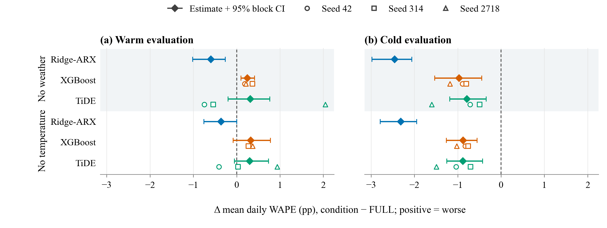

# Incremental Value of Weather and Calendar Inputs in Hour-Ahead Load Forecasting

Research companion for the current manuscript draft. The repository name identifies the intended project; conference acceptance, a publication date, and a DOI have not been verified. Author information is awaiting confirmation. This repository is private and contains selected publication aggregates, portable experiment code, and the manuscript source.

The research question is whether explicit weather, calendar, and thermal inputs add forecasting value when 168 hours of recent load are already available. Ridge-ARX, XGBoost, and a locally corrected TiDE provide three different model families under matched inputs. Each forecasts one hour ahead with fixed fitted weights and updated observed history.



In cold evaluation, removing weather reduces mean daily WAPE by about 2.45, 0.97, and 0.79 percentage points for Ridge-ARX, XGBoost, and TiDE. Warm-window effects vary by family and TiDE initialization. Peak-error conclusions can differ from average-error conclusions. These are retrospective conditional predictive comparisons, not causal effects or evidence of general architectural superiority. The windows were previously inspected, overlap in their roles, and are not independent holdouts. September exclusion sensitivity in the current paper is TiDE-only.

## Two levels of reproduction

| Route | Inputs | What it establishes |
|---|---|---|
| Publication artifacts | Included reviewed summary CSVs, manuscript and fixed configuration | Regenerates figures and tables, checks their numerical correspondence, and optionally builds the PDF |
| Full experiments | Privately supplied hourly observations and the training dependencies | Reconstructs preprocessing, selects thermal parameters and baseline hyperparameters, fits all conditions, predicts, ensembles, and evaluates |

**Replotting summary CSVs does not retrain models or independently calculate confidence intervals from hourly predictions.** The historical reference results stay separate from new executions. No raw observations, hourly forecast files, or model weights are distributed.

## Quickstart: publication artifacts

Use Python 3.12. From a clean clone:

```sh
git clone https://github.com/salehmh10/sgc2026-load-input-value.git
cd sgc2026-load-input-value
python -m venv .venv
```

Activate on Windows PowerShell with `.\.venv\Scripts\Activate.ps1`, or on Linux with `source .venv/bin/activate`. Then:

```sh
python -m pip install ".[dev]"
python scripts/reproduce_artifacts.py
python scripts/reproduce_artifacts.py --check-only
python -m pytest -q
python scripts/audit_release.py
```

Outputs go to `results/reproduced/`, an ignored directory. The paper uses the reviewed figure and table copies under `paper/`. Inspect [the artifact map](docs/artifact-map.md) for each output's data, configuration or fixed-artifact status. With `pdflatex` and `bibtex` installed:

```sh
python scripts/build_paper.py
```

The PDF builder creates its own output directory and records diagnostics. See [reproduction details](docs/reproduction.md), [validation status](docs/validation.md), and [environment versions](docs/environments.md).

## Private-data experiments

Install the separate training dependencies in an isolated environment. The source CSV must satisfy [the data contract](docs/data-contract.md). Its path is supplied explicitly; no original project folder, saved private cache, or user profile is required.

```sh
python -m pip install ".[train,dev]"
liv experiment smoke --output outputs/synthetic-smoke
liv experiment run --data data/private/observations.csv --output outputs/paper-run --config configs/paper.json
```

The smoke run uses clearly labeled synthetic data and a deliberately small budget. It validates execution, not paper accuracy. The full command is explicit and potentially expensive: the paper protocol includes 42 TiDE, 14 Ridge-ARX, and 42 XGBoost final fits plus selection fits. Full training was not performed during repository assembly. Supply a fresh output directory for each execution. Keep private inputs and outputs out of Git.

The seven retrained conditions are `FULL`, `NO_DERIVED`, `NO_TEMP`, `NO_HUMIDITY`, `NO_CALENDAR`, `NO_WEATHER`, and `FULL_PROXY`. The portable code retains the local TiDE scalar-decoder LayerNorm correction, Train-fitted preprocessing and masking, fixed 7,088-column flattening, observed-target scoring, seed averaging before scoring, and the original objective and selection rules. See [methodology](docs/methodology.md) and [portability changes](docs/portability.md).

## Repository map

```text
src/load_input_value/  Portable private-data pipeline and numerical definitions
configs/              Explicit paper protocol
scripts/              Artifact reproduction, PDF build and publication audit
tests/                Synthetic scientific controls and artifact validation
results/reference/    Immutable admitted historical aggregates and checksums
paper/                Manuscript, bibliography, reviewed figures and tables
data/                 Data contract pointers; no private observations
docs/                 Methods, provenance, environment and validation records
.github/workflows/    Light reproduction CI without secrets or training
```

Find every figure and table in [docs/artifact-map.md](docs/artifact-map.md), source-to-publication mappings in [docs/provenance.md](docs/provenance.md), and interpretation/access limits in [docs/limitations.md](docs/limitations.md). A passing light CI verifies the artifact route; it does not certify a new full model run.

## Citation and permissions

The exact manuscript title above and this repository's URL are currently confirmed. Author identities, affiliations, and corresponding-author information have not been supplied. [CITATION.cff.in](CITATION.cff.in) is an explicitly incomplete template, not valid final citation metadata; it must be completed with confirmed authors before becoming `CITATION.cff`. No author, DOI, or acceptance status is inferred from a GitHub account.

No general software license has been chosen. See [LICENSE-STATUS.md](LICENSE-STATUS.md). Existing third-party LaTeX notices are preserved in [THIRD_PARTY_NOTICES.md](THIRD_PARTY_NOTICES.md). Any future code license must be distinguished from rights to the manuscript and underlying data.
